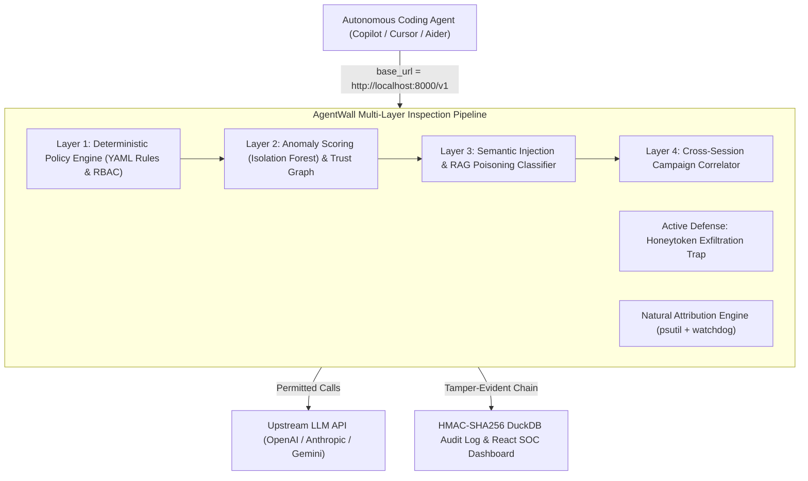

<div align="center">


# AgentWall

**AI Agent Security Firewall for Autonomous Coding Agents**

[](https://github.com/Ashin-06/AgentWall/actions/workflows/verify.yml)
[](LICENSE)
[](https://www.python.org/)

*A transparent security proxy that sits between autonomous AI coding agents and their LLM APIs - monitoring, attributing, and enforcing policy on every tool call, without breaking agent workflows.*

</div>


---

## Features

| Component | Description |
|---|---|
| **Natural Attribution Engine (NAE)** | Uses `psutil` process monitoring and `watchdog` filesystem events to identify which AI agent modified a file. No TLS interception or agent-side modification required. |
| **HMAC-Chained Audit Logs** | Each log entry is cryptographically linked to the previous via HMAC-SHA256. Any modification to a past record breaks the chain. |
| **Honeytoken Active Defense** | Fake credentials are placed in the agent's context. If an agent uses them in a tool call, the event is flagged as a confirmed exfiltration attempt. |
| **MITRE ATT&CK Mapping** | Tool calls that match policy rules are tagged with the corresponding MITRE ATT&CK technique ID. |
| **Multi-Layer Detection Pipeline** | Four detection layers: deterministic policy rules, anomaly scoring (Isolation Forest), semantic injection detection, and cross-session campaign correlation. |
| **SOC Dashboard** | A React interface that displays live sessions, blocked calls, MITRE heatmaps, and session replay. |

---

##  Evaluation Results

> **Transparency Notice**: Each result below clearly states whether it was measured on real running code or via a controlled simulation. No numbers are estimated or invented.

---

###  Real-World Results - Policy Engine (`evals/run_benchmarks.py`)

These results are from **actual FastAPI server calls** using Python's `TestClient` against a live in-memory instance of AgentWall. Reproducible by running `python evals/run_benchmarks.py`.

| Metric | Result | Dataset Size | What Was Tested |
|---|---|---|---|
| True Positive Rate (TPR) | **100%** | 25 malicious calls | Layer 1 YAML policy rules correctly blocked all 25 attack patterns |
| False Positive Rate (FPR) | **0%** | 25 benign calls | No legitimate operations were incorrectly blocked |
| Average Intercept Latency | **~25 ms** | 50 total calls | End-to-end: request in -> policy check -> audit write -> response out |

>  **Scope Limitation**: TPR/FPR apply to Layer 1 (deterministic YAML policy rules) only. The ML layers are mocked here and in the unit tests. Layer 3 (the LLM injection classifier) is evaluated separately against a real local model on a held-out split of public data; see [docs/EVALUATION.md](docs/EVALUATION.md) and the summary below. Layer 2 (Isolation Forest, RAG detector) has not been evaluated on real data.

### Real-model results - Layer 3 injection classifier (`evals/ml_eval.py`)

Held-out test split of 366 rows (deepset/prompt-injections test, JailbreakBench behaviors, agent tool-call fixtures), block threshold 0.8, laptop RTX 3060 via Ollama:

| Model | Precision | Recall | F1 | Recall on deepset injections | p50 latency |
|---|---|---|---|---|---|
| llama3.2:3b | 0.898 | 0.524 | 0.662 | 0.067 | 1.2 s |
| llama3.1 8B (default) | 0.922 | 0.643 | 0.758 | 0.217 | 3.6 s |
| heuristic fallback (no model) | 0.812 | 0.070 | 0.129 | 0.033 | < 1 ms |

Most real prompt injections get past the LLM layer. Its recall comes mainly from harmful requests and from tool calls that Layer 1 already blocks.

---

###  Algorithm Simulation - Attribution Engine (`evals/attribution_accuracy.py`)

These results validate the **logic** of the Multi-Signal Attribution (MSA) algorithm using a deterministic simulation (`AttributionOracle` class). The simulation does **not** invoke `psutil`, does **not** scan the real OS process table, and does **not** measure actual filesystem event latency.

| Scenario | Result | Trials | What Was Tested |
|---|---|---|---|
| Single-agent attribution (no concurrency) | **100% correct** | 50 | Correct candidate scoring and label assignment |
| Dual-agent, distinct file paths | **100% correct** | 40 | Signal 1 (file handle) separates agents correctly |
| Two agents writing the same file simultaneously | **`contested` flag raised 100%** | 10 | Conflict detection when attribution is ambiguous |
| MSA algorithm computation time (P99) | **< 0.05 ms** | 100 | Pure algorithm overhead, no I/O |

>  **Scope Limitation**: These numbers do **not** characterize real-world `psutil` process-scan latency or filesystem event timing on a live OS. In practice, `psutil.process_iter()` takes 50-500 ms depending on the number of running processes and OS permissions. See [ATTRIBUTION.md](ATTRIBUTION.md) for full methodology details and known limitations.

---

###  Unit Tests - Core Security Logic (`tests/`)

Automated deterministic tests run on every commit via GitHub Actions.

| Test | Status | What It Verifies |
|---|---|---|
| `test_health` |  Pass | Server starts and API is reachable |
| `test_login_success` |  Pass | JWT authentication works correctly |
| `test_login_failure` |  Pass | Wrong password is correctly rejected (401) |
| `test_metrics_endpoint` |  Pass | Prometheus metrics endpoint returns data |
| `test_policy_permit_benign_tool` |  Pass | Benign `list_directory` call is permitted |
| `test_policy_block_malicious_path` |  Pass | Read of `/etc/passwd` is blocked |
| `test_policy_block_system_command` |  Pass | `rm -rf /` command is blocked |

These tests use `unittest.mock` to patch ML-layer dependencies, ensuring fast deterministic runs in CI. `tests/test_real_model.py` exercises the real model and is skipped when Ollama is not available.

---

##  Architecture



```
AI Agent (Copilot / Cursor / Aider)
         |
         | base_url = http://localhost:8000/v1
         v
+-------------------------------------------------+
|              AgentWall Proxy                    |
|                                                 |
|  Layer 1: Policy Engine (YAML rules, RBAC)      | <- Deterministic BLOCK/PERMIT
|  Layer 2: Anomaly + Trust Graph                 | <- Isolation Forest + Delegation
|  Layer 3: Semantic Injection + RAG Detector     | <- LLM-assisted classification
|  Layer 4: Campaign Correlator                   | <- Cross-session attack clustering
|                                                 |
|  Active Defense: Honeytoken Check               | <- 0% FPR confirmed attack signal
|  Audit: HMAC-Chained DuckDB                     | <- Tamper-evident forensic log
+-------------------------------------------------+
         |
         v
  LLM API (OpenAI / Anthropic / Gemini)
```

### Component Summary

| Component | Technology | Status |
|---|---|---|
| Proxy Core | FastAPI + uvicorn |  Implemented & tested |
| Policy Engine | Compiled YAML rules |  Implemented & tested |
| Natural Attribution Engine | `psutil` + `watchdog` |  Implemented; algorithm validated via simulation |
| Audit Log | DuckDB + HMAC-SHA256 |  Implemented & tested |
| Anomaly Detection | Isolation Forest (scikit-learn) |  Implemented; requires traffic data to train |
| Semantic Injection Classifier | LLM via Ollama |  Implemented; evaluated with a real model in [docs/EVALUATION.md](docs/EVALUATION.md) (low recall on prompt injection) |
| SOC Dashboard | React + WebSocket |  Built; served from `dashboard/dist/` |
| Redis Scaling | Optional (`redis-py`) |  Graceful fallback to local memory if absent |

---

##  Honest Technical Limitations

Full STRIDE threat model in [THREAT_MODEL.md](THREAT_MODEL.md).

| Limitation | Detail |
|---|---|
| **Not a network firewall** | Agents must explicitly set `base_url`. Agents that hardcode `api.openai.com` will bypass monitoring entirely. |
| **Proxy-aware bypass** | A sophisticated agent detecting it is being proxied could route directly to the LLM API. Mitigation requires OS-level iptables/eBPF (out of scope). |
| **Heuristic attribution** | The NAE uses CPU% as a proxy for "recently active" because `psutil` does not provide windowed CPU history without polling. In a high-concurrency environment with many processes, false attribution is possible - handled by the `contested` flag. |
| **ML layers need a live LLM** | Layer 3 produces meaningful output only when a model is running; without one it falls back to a heuristic that catches 7% of attacks. With llama3.1 8B it catches 22% of real prompt injections (docs/EVALUATION.md). In CI the ML layers are mocked. |
| **Attribution not validated on real processes** | The MSA algorithm logic is validated via simulation. Real `psutil` scanning on a live OS with multiple agents has not been formally benchmarked yet. |
| **Dashboard token in localStorage** | The dashboard keeps its JWT (1 hour by default) in `localStorage`, so script injected into the dashboard origin could read it. The dashboard renders no HTML from events and the API sets no cookies, which avoids CSRF; moving the token to an httpOnly cookie would need CSRF protection and has not been done. Keep `AGENTWALL_JWT_TTL` short. |

---

##  Related Work

A structured comparison against LiteLLM, Guardrails-AI, and OWASP LLM Top 10 mitigations is in [COMPARISON.md](COMPARISON.md).

---

##  Quick Start

### Prerequisites
- Python 3.10+
- Node.js *(only needed to rebuild the React dashboard)*

### Installation

```bash
git clone https://github.com/Ashin-06/AgentWall.git
cd AgentWall
pip install -r requirements.txt
cp .env.example .env  # edit as needed
```

### Start the Server

```bash
python -m uvicorn agentwall.main:app --host 127.0.0.1 --port 8000 --ws websockets
```

### Run with Docker Compose

Put strong values for `AGENTWALL_ADMIN_PASSWORD`, `AGENTWALL_API_KEYS`, `AGENTWALL_JWT_SECRET` and `AGENTWALL_HMAC_KEY` in `.env` (for example `python -c "import secrets; print(secrets.token_hex(32))"`), then:

```bash
docker compose up --build -d
```

Compose refuses to start without those four values. The container runs as a non-root user; the audit database and models live in the `agentwall-data` volume at `/data`. Upgrading from a version that bind-mounted `./agentwall_v2.duckdb`: copy that file into the volume as `/data/db/agentwall.duckdb` before starting.

### Point Your Agent at AgentWall

```python
# OpenAI SDK example
from openai import OpenAI
client = OpenAI(base_url="http://localhost:8000/v1", api_key="your-key")
```

The dashboard is available at `http://localhost:8000`. The password is `AGENTWALL_ADMIN_PASSWORD` from your `.env`; if that's empty, a random one is printed when the server starts. The example `.env` has no keys or secrets in it: set `AGENTWALL_API_KEYS` for your agents, and strong secrets before listening on anything but `127.0.0.1`. `AGENTWALL_ENV=production` refuses to start with weak or example values.

---

##  Running the Evaluation Suite

```bash
# Real-world policy evaluation (25 benign + 25 malicious calls, live server)
python evals/run_benchmarks.py

# MSA algorithm logic validation (simulation - does NOT use real psutil)
python evals/attribution_accuracy.py

# Layer 3 with a real model (needs Ollama; see docs/EVALUATION.md)
python evals/ml_eval.py --split test --threshold 0.8 --model llama3.2:3b

# Deterministic unit tests (mock ML layers, CI-safe)
python -m pytest tests/ -v

# Dashboard end-to-end tests (Cypress) against a running server on :8000
# started with the same AGENTWALL_ADMIN_PASSWORD and AGENTWALL_API_KEYS
cd dashboard && npm run build && npm run e2e
```

---

## Pre-deployment check (vibeaudit)

CI runs [vibeaudit](https://pypi.org/project/vibeaudit/) on every push and pull request and fails on any high or critical finding:

```bash
pip install vibeaudit
vibeaudit scan . --fail-on high
```

Findings that were reviewed and are not defects are suppressed inline with `vibeaudit: ignore[RULE]` and a reason:

| Rule | Where | Why it is not a defect |
|---|---|---|
| BE001 | `agentwall/audit/schema.py` | Only the driver placeholder (`?` or `%s`) is spliced into the SQL; every value, including `LIMIT`, is a bound parameter. |
| BE009 | `agentwall/main.py` intercept route | `InterceptRequest` is a pydantic validation model; nothing is written from it directly. |
| SEC011 | `agentwall/active_defense/honeytoken.py` | Decoy credentials are the honeytoken feature. |
| SEC011 | `dashboard/src/components/AttackGraph.jsx` | `PASS` is a verdict colour. |
| SEC010 | `agentwall/main.py` | Prints a one-time generated dashboard password only when none is configured; production mode refuses to start without one. |
| QA007 | `adapters/`, `agentwall/audit/postgres_queue.py` | Optional integrations (Anthropic, LangChain, PostgreSQL), not needed by the core proxy. |

Fixed rather than suppressed: the session and violation `LIMIT` values are now bound parameters, vite moved to 6.4 (8 advisories against 5.4), and an unused `agentwall/layer1/rbac.py` with hard-coded bindings was removed.

##  Documentation

| Document | Contents |
|---|---|
| [ARCHITECTURE.md](ARCHITECTURE.md) | System design, data flow, pipeline diagram |
| [ATTRIBUTION.md](ATTRIBUTION.md) | Formal MSA algorithm spec with honest limitations |
| [THREAT_MODEL.md](THREAT_MODEL.md) | Full STRIDE threat model, out-of-scope threats |
| [COMPARISON.md](COMPARISON.md) | Structured comparison vs. LiteLLM, Guardrails-AI, OWASP |
| [CONFIGURATION.md](CONFIGURATION.md) | Policy YAML syntax, environment variables |
| [docs/EVALUATION.md](docs/EVALUATION.md) | Real-model evaluation of the Layer 3 classifier: data, method, precision/recall/F1, latency |
| [ROADMAP.md](ROADMAP.md) | Future work - real-world attribution benchmark, ML eval |
| [VERIFICATION.md](VERIFICATION.md) | Manual security control verification procedures |
| [deploy/k8s/README.md](deploy/k8s/README.md) | Kubernetes manifests (single replica), validated in CI with kubeconform |

---

<div align="center">

**License: MIT**

</div>
